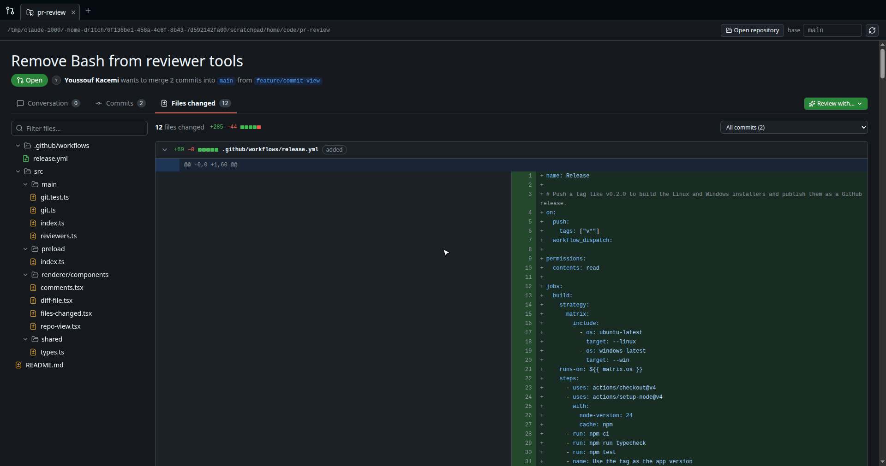
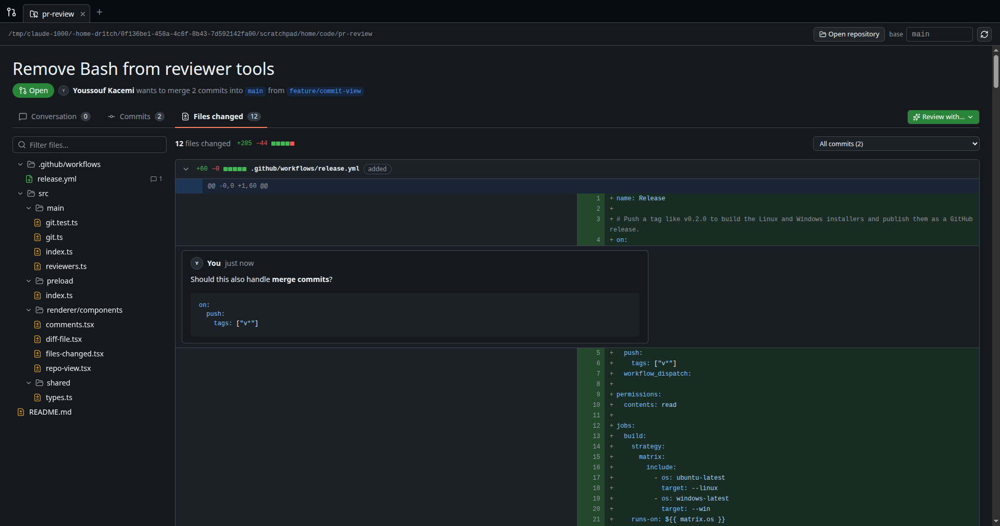
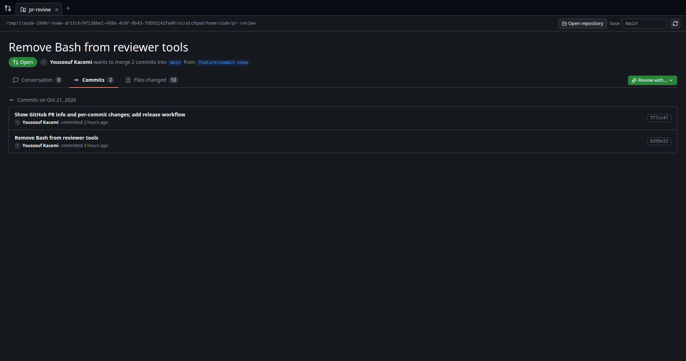
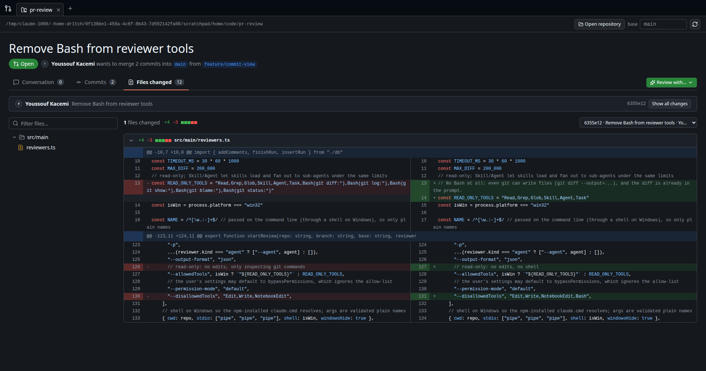
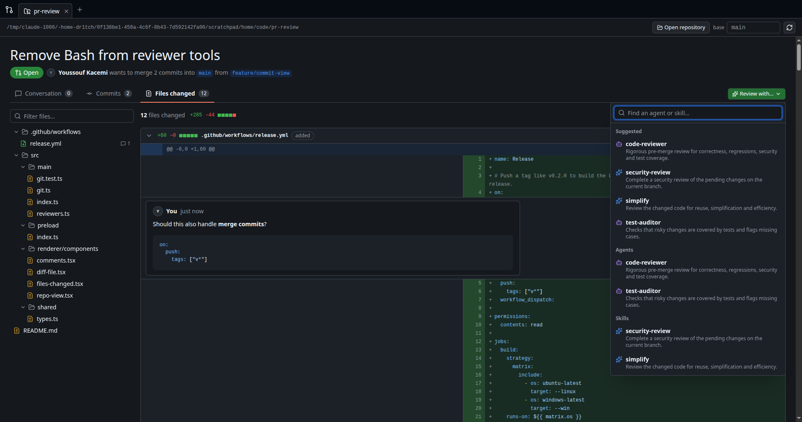

# PR Review

Review your local branch like a GitHub pull request, before you push it, with Claude Code agents as reviewers.



PR Review is a desktop app for Linux and Windows. Open a git repository and it shows `HEAD` against a base branch the way GitHub shows a pull request: a split diff with syntax highlighting, a file tree, the commit list and inline Markdown comments. Pick any of your Claude Code agents or skills from **Review with…** and its findings land as comments on the right lines.

## Features

- **GitHub-style diff:** split view, GitHub dark theme and syntax highlighting, a filterable file tree, and per-file `+/-` counts.
- **Inline comments:** click `+` on any line and write Markdown (with preview). Comments are stored locally in SQLite.
- **Commits:** commits grouped by day with author avatar and hash. Click a commit to see only its changes.
- **Claude Code reviewers:** runs your agents and skills headless and read-only, then posts their findings as inline comments. Runs can be cancelled.
- **Real PR context:** when `gh` is logged in, it shows the GitHub PR's title, description, number and author.
- **Rebase-aware:** reload fetches `origin` and compares against the remote base when it is ahead, so a rebase doesn't show other people's changes.
- **Tabs:** open several repositories at once.

## Install

Download the `.deb`, AppImage or Windows installer from [Releases](https://github.com/dr1tch/pr-review/releases).

```bash
sudo apt install ./pr-review_*_amd64.deb
```

On Ubuntu 24.04+, prefer the `.deb`. AppArmor blocks the AppImage's sandbox unless you start it with `--no-sandbox`.

### Requirements

- `git` on `PATH`.
- [Claude Code](https://docs.claude.com/en/docs/claude-code) (`claude`) on `PATH`, logged in, to run reviews.
- Optional: [GitHub CLI](https://cli.github.com) (`gh`), logged in, for PR titles, descriptions and avatars.

## Usage

1. Click **Open repository** and pick a git repository on the branch you want to review.
2. Set the **base** branch (default `master`).
3. Read the diff in **Files changed** and add comments with the `+` on any line.
4. Click **Review with…** and pick an agent or skill. Its findings show up as comments when it finishes.

Reviewers are found the same way Claude Code finds them:

| Source | Location |
|---|---|
| User | `~/.claude/agents`, `~/.claude/skills` |
| Project | `<repo>/.claude/agents`, `<repo>/.claude/skills` |
| Plugins | agents and skills of your enabled Claude Code plugins |

Reviews run `claude -p` in the repository with read-only tools (`Read`, `Grep`, `Glob`, `Skill`, `Agent`, `Task`). Edits and the shell are disallowed. The diff is passed in the prompt, and the reply's trailing JSON block becomes inline comments.

## Screenshots

| Files changed | Commits |
|---|---|
|  |  |
| **Single commit** | **Review with an agent or skill** |
|  |  |

## Development

Electron, React, Tailwind and `node:sqlite` (no native modules). Needs Node 24.

```bash
npm install
npm run dev                  # run with hot reload
npm test && npm run typecheck
npm run dist:linux           # dist/*.AppImage + dist/*.deb
npm run dist:win             # dist/PR Review Setup *.exe (needs wine on Linux)
```

Data lives in `pr-review.db` in the app's user-data folder: `~/.config/pr-review/` on Linux, `%APPDATA%\pr-review\` on Windows.

### Releasing

Push a version tag. `.github/workflows/release.yml` builds the Linux and Windows installers and attaches them to a GitHub release.

```bash
git tag v0.3.0 && git push origin v0.3.0
```
